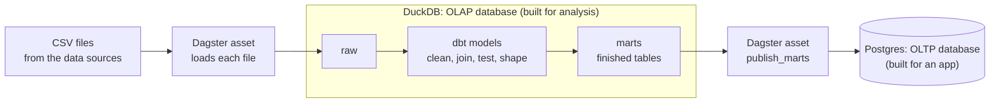
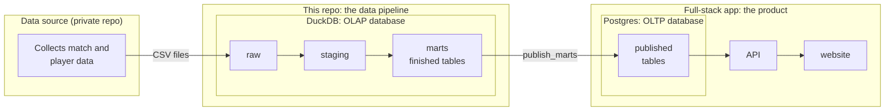

# WSL pipeline

> Explore all of the data pipeline's transformations in the [dbt docs here](https://wsl-demo.github.io/wsl-pipeline/).

A small, local data pipeline for Women's Super League data. It's a learning
project: a free, laptop-sized version of the orchestrated ingestion,
transformation and publishing setup used on a production data team.



## Where this fits

This repo is the middle of three separate projects. Each one keeps its own code
and its own credentials, and they only meet by handing over data.



| Project | Job | Database |
| --- | --- | --- |
| Data source | Collect the data and write CSV files. Nothing else. | None |
| This repo | Turn raw files into tidy, tested tables, and hand over the finished ones. | DuckDB, an OLAP database (built for analysis) |
| Full-stack app | Serve the finished tables to users. It does no data cleaning of its own. | Postgres, an OLTP database (built for an app) |

Two databases is on purpose. The pipeline works in an **OLAP** (online analytical
processing) database, DuckDB, which is built for big scans and joins across whole
tables. It then publishes the finished tables to an **OLTP** (online transaction
processing) database, Postgres, which is built for the many small, quick lookups
an application makes. This is the same shape a production team has: a warehouse
for analysis feeding an operational database for the product. The app only ever
sees the finished tables, so a broken pipeline run can't leave it showing
half-cleaned data.

## How the pipeline works

1. **Ingest.** Dagster loads each CSV file from the data sources into DuckDB,
   exactly as it arrived, with every column kept as text. Nothing is cleaned
   here, so everything downstream can always be rebuilt from raw.
2. **Transform.** dbt turns raw data into finished tables in three steps:
   *staging* tidies each raw table, *intermediate* joins and derives, and *marts*
   are the entities the app wants to read.
3. **Test.** Tests run alongside the models. Each mart also makes a promise about
   its columns and types, so a change that would break the app fails the build
   instead.
4. **Publish.** A Dagster asset, `publish_marts`, sits at the end of the graph,
   downstream of every mart. It writes the finished tables into the full-stack
   app's Postgres, into a schema (`analytics`) only this pipeline can write to,
   and the app reads them from there. The tables are swapped in together, so the
   app never sees half of a new set. If any test fails, the asset doesn't run and
   the app keeps the last good data.

## Ideas that hold it together

- **One ID across sources.** The data sources identify players and teams with the
  same Opta IDs, so they join directly. Each source's own IDs stay in staging.
- **Everything belongs to a season.** Seasons run from 1 July to 30 June and are
  written `2026-2027`. The rule is defined once and reused everywhere.
- **Raw is never edited.** Every other layer is disposable and can be rebuilt.
- **The app gets finished, tested tables or nothing.**

## Looking around

The models themselves are documented where they live, so this README doesn't
repeat them:

- **`just dagster`** opens the Dagster UI (<http://localhost:3000>) with the
  lineage graph, runs and test results.
- **`just docs`** builds and serves the dbt docs, with every model, column,
  description and test.

## Getting started

```bash
cp .env.example .env   # then point WSL_RAW_DIR at the CSV directory
uv sync
just setup             # ingest everything and build every model
just publish           # the same, then hand the marts to the app
just dagster           # explore lineage and runs at http://localhost:3000
```

See [CONTRIBUTING.md](CONTRIBUTING.md) for the day-to-day development workflow.
